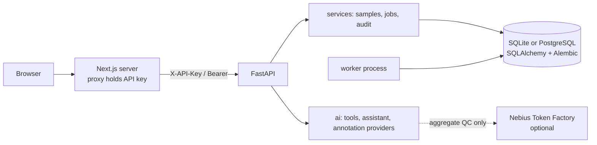

# GenomeDesk — AI-Powered Genomic Research Workspace

An extensible platform for genomic variant exploration, quality-control analysis, and evidence-grounded AI research assistance.

> **Research and development use only.** GenomeDesk is **not** a validated clinical diagnostic device. It provides no diagnosis, pathogenicity classification or medical advice, and no regulatory certification or compliance has been assessed. Use synthetic or approved data.

## 1. Project overview

GenomeDesk imports small VCF / VCF.gz files, stores variants in a relational database, computes real QC statistics, and offers a Next.js dashboard and an optional Nebius-powered assistant that explains *only* the measurements it is given. The original v0.1 API contract is preserved (see [docs/api.md](docs/api.md)).

## 2. Current implementation status

| Status | Features |
|---|---|
| **Implemented and tested** | VCF and `.vcf.gz` import with format/size/assembly validation and SHA-256 checksums; aggregate QC; chromosome/quality/allele (REF/ALT) filtering; CSV/JSON variant and summary downloads; SQLAlchemy models (SQLite + PostgreSQL) with reversible Alembic migrations; identity-based auth (signed expiring tokens, scrypt passwords), project roles and cross-project denial; audit log, rate limits, retention/deletion; async job worker (`variant_summary`); legacy `/explain` endpoint; assistant orchestration with mocked provider; OpenAPI compatibility check |
| **Implemented but experimental** | Next.js frontend (lint, typecheck and build pass in CI; not covered by automated UI tests; frontend uses the dev API-key compatibility mode); conversational Nebius assistant (tested against a mocked provider only, never a live key); versioned annotation-provider abstraction (stored records only); PostgreSQL support (migration tested in CI; no production load testing) |
| **Planned** | FASTQ upload, FastQC, MultiQC, alignment, variant calling, VCF generation, pipeline provenance via version-pinned Nextflow/nf-core (interfaces/design only, see `/api/jobs/pipelines`); browser login UI for multi-user mode; Redis-backed distributed rate limiting |
| **Not supported** | FASTQ/BAM/CRAM processing, ClinVar or other pathogenicity claims (needs variant normalisation + assembly-aware matching), clinical interpretation, genome-wide coverage metrics from VCFs, BCF, liftover between assemblies |

## 3. Key capabilities

- Real computed metrics only; null metrics are shown as unavailable, never as zero.
- Assistant answers separate **direct measurements**, **retrieved evidence** and **model-generated interpretation**, and list sources/versions, retrieval date, limitations and a research-use disclaimer.
- Explicit demo mode in the frontend with clearly labelled synthetic data.

## 4. Architecture



Layout: `app/{api,auth,db,schemas,services,bioinformatics,ai,workers}`, `frontend/`, `migrations/`, `tests/`, `docs/`. Details: [docs/architecture.md](docs/architecture.md).

## 5. Technology stack

FastAPI, SQLAlchemy 2, Alembic, pysam, OpenAI SDK (Nebius-compatible endpoint), pytest, Ruff; Next.js 15, TypeScript, Tailwind CSS, Recharts, TanStack Table.

## 6. Prerequisites

Python 3.12, Node.js 22 (frontend), Docker (optional), PostgreSQL 16 (optional).

## 7. Quick start

Local:

```bash
python -m venv .venv && source .venv/bin/activate
pip install -r requirements-dev.txt
cp .env.example .env     # set BACKEND_API_KEY (python -c "import secrets; print(secrets.token_urlsafe(32))")
uvicorn app.main:app --reload --host 127.0.0.1 --port 8000
python -m app.workers.worker     # separate terminal: async job worker (optional)
```

Frontend (separate terminal):

```bash
cd frontend && cp .env.example .env.local   # set BACKEND_API_KEY to the same value (server-side only)
npm ci && npm run dev                       # http://localhost:3000
```

Docker:

```bash
docker compose up --build                       # API + worker
docker compose --profile frontend up --build    # also the frontend
```

Upload the synthetic example (interactive docs at <http://localhost:8000/docs>):

```bash
curl -H "X-API-Key: $BACKEND_API_KEY" \
  -F file=@examples/synthetic.vcf -F assembly=GRCh38 -F sample_name=synthetic-demo \
  http://localhost:8000/api/samples
```

## 8. Environment configuration

See [.env.example](.env.example); it contains placeholders only — never commit `.env`. Optional services (Nebius, PostgreSQL, worker, frontend) are not required for a basic local VCF demo.

## 9. API reference

Swagger UI: `/docs`; schema: `/openapi.json`; summary and compatibility notes: [docs/api.md](docs/api.md).

## 10. Frontend usage

Pages: `/dashboard`, `/projects`, `/samples`, `/samples/[id]`, `/variants`, `/assistant`, `/jobs`. All backend calls go through a server-side proxy so credentials never reach browser JavaScript. Append `?demo=1` for demo mode (banner shown, synthetic data only). See [frontend/README.md](frontend/README.md).

**Screenshots:** _none committed yet — real screenshots will be added once captured from a running instance._

## 11. AI integration (Nebius Token Factory)

Set `NEBIUS_API_KEY` and `NEBIUS_MODEL` **in the backend environment only** (never in the frontend or `NEXT_PUBLIC_*`). The endpoint is `https://api.tokenfactory.nebius.com/v1/`.

- `POST /api/samples/{id}/explain` — unchanged v0.1 endpoint.
- `POST /api/assistant/chat`, `POST /api/assistant/summary` — conversational assistant with follow-up context, backed by project-scoped tool functions.
- Privacy default: only pseudonymous labels and aggregate QC are sent. Variant-level records are sent only if you set `AI_SHARE_VARIANT_LEVEL=true`.
- Without Nebius configuration the API returns a clear `unavailable` status (direct measurements are still shown); provider failures return `provider_error` and never crash the app.
- No ClinVar integration: it will only be added after reliable normalisation and assembly-aware matching exist.

## 12. Supported genomic formats

`.vcf` and `.vcf.gz` (gzip, not BGZF-indexed requirement) with a `##fileformat=VCF` header, GRCh37/GRCh38 declared at upload (header `##reference` conflicts are rejected). Limits: `MAX_UPLOAD_BYTES`, `MAX_DECOMPRESSED_BYTES`, `MAX_RECORDS`. Not supported: BCF, FASTQ, BAM/CRAM.

## 13. Testing and CI

```bash
ruff check app tests scripts
python -m pytest -q
python -m scripts.check_openapi_compat
cd frontend && npm run lint && npm run typecheck && npm run build
```

GitHub Actions (`.github/workflows/ci.yml`) runs Ruff, pytest (with PostgreSQL migration up/down), the OpenAPI contract check, frontend lint/typecheck/build, `npm audit`, `pip-audit`, gitleaks secret scanning and Docker image builds. All genomic test data is synthetic.

## 14. Security and privacy

Identity-based auth with project roles (owner/editor/viewer), 404 for other projects, audit events, per-client rate limits, upload limits, gzip-bomb protection, CSV formula-injection protection, no tokens/genomic content in logs. The shared `X-API-Key` mode is a **development compatibility mode** mapped to one default project; disable it with `LEGACY_API_KEY_ENABLED=false`. Rate limiting is in-process (single instance). See [docs/architecture.md](docs/architecture.md#security-model).

## 15. Research limitations

VCF INFO/DP is site depth, not genome-wide coverage; no read-level QC, annotation or pathogenicity is produced; reference verification relies on header labels.

## 16. Roadmap

See [docs/roadmap.md](docs/roadmap.md).

## 17. Contributing

Open an issue or PR; run the checks in section 13 first. Use synthetic data only.

## 18. License

MIT — see [LICENSE](LICENSE).
